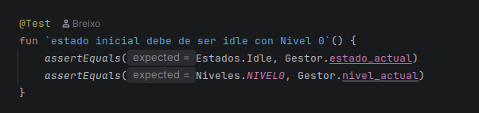
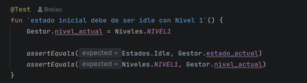
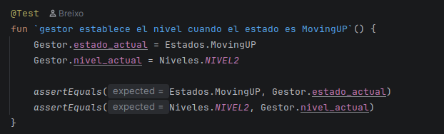
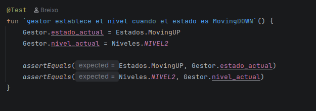
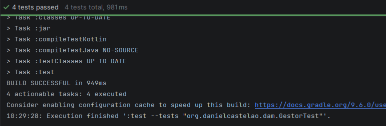
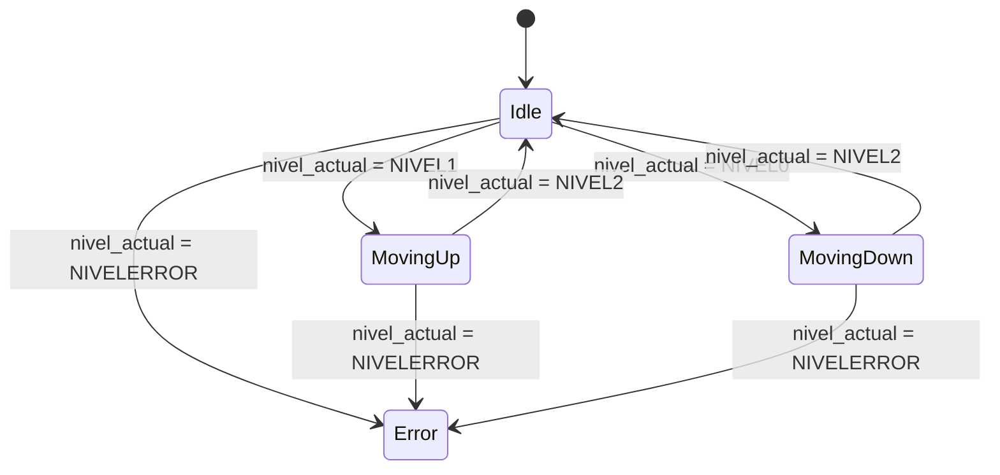

# Maquina de Estados - Ascensor Halo

## Descripción del proyecto

Este proyecto simula la funcionalidad de un ascensor con dos plantas disponibles, en las 
que cambia a un estado de subir o bajar según la planta inicial.

## Estados del ascensor:

- Idle: Estado de reposo del ascensor, donde se decide si este sube o baja
- MovingUP: Estado de movimiento ascendente. Solo se puede iniciar desde la planta inferior, o el NIVEL 0 en este caso
- MovingDown: Estado de movimiento descendente. Solo se puede iniciar desde la planta superior, o el NIVEL 1 en este caso
- Error: Estado de error que puede darse al introducir ordenes de movimiento mientras el ascensor esta funcionando

## Niveles y transiciones

Se ha implementado una Enum class para controlar los niveles en los que se encuentra el ascensor. Se encuentran en
`Niveles.kt` y son los siguientes:

- `NIVEL0`: Primera planta, que pertenece a la avenida Garcia Borbón
- `NIVEL1`: Segunda planta, que pertenece a la plaza de Compostela
- `NIVEL2`: Nivel intermedio entre las plantas, que representa al ascensor en movimiento
- `NIVELERROR`: Pertenece a un nivel -1, que representa el estado de error

## Tests

## Diagrama de estados

